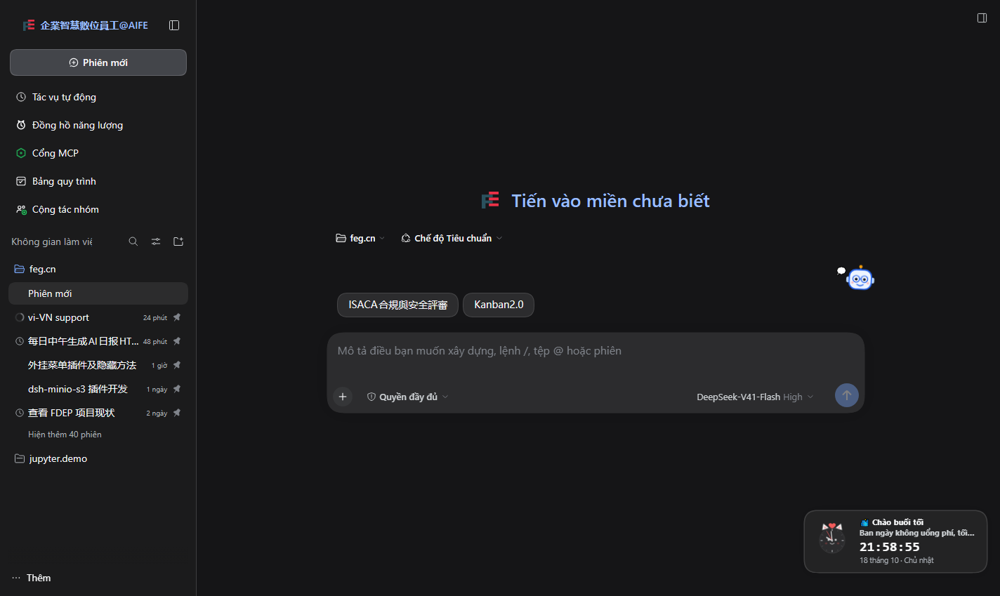
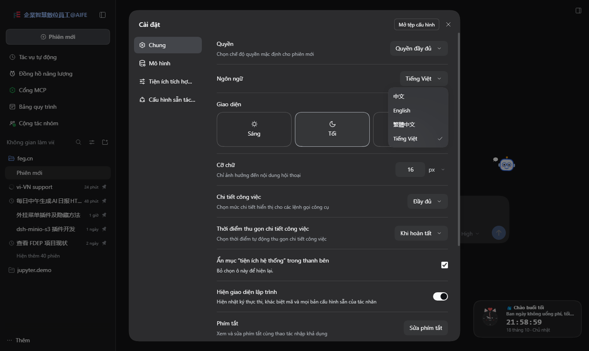
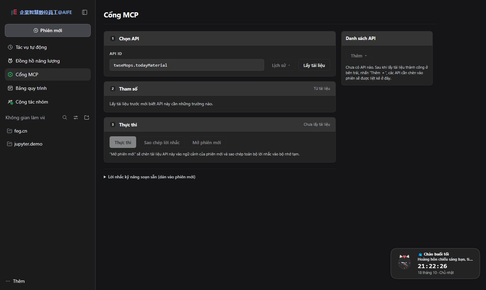
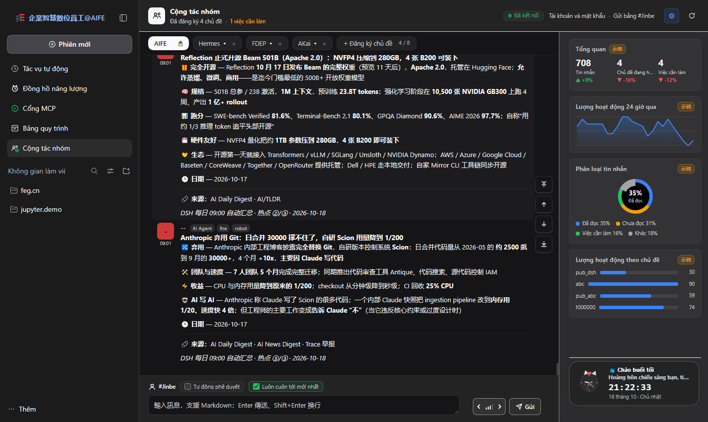
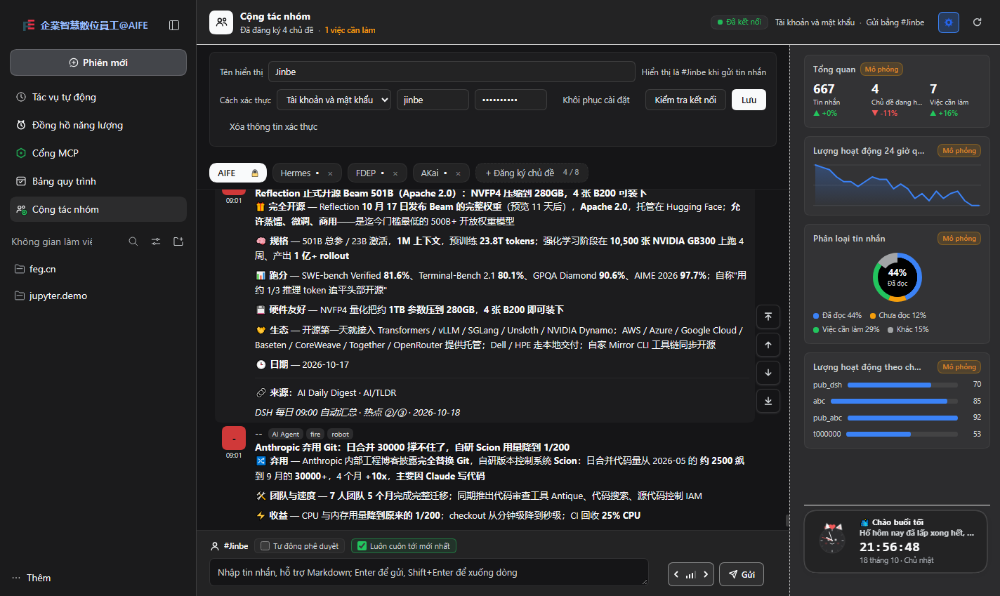
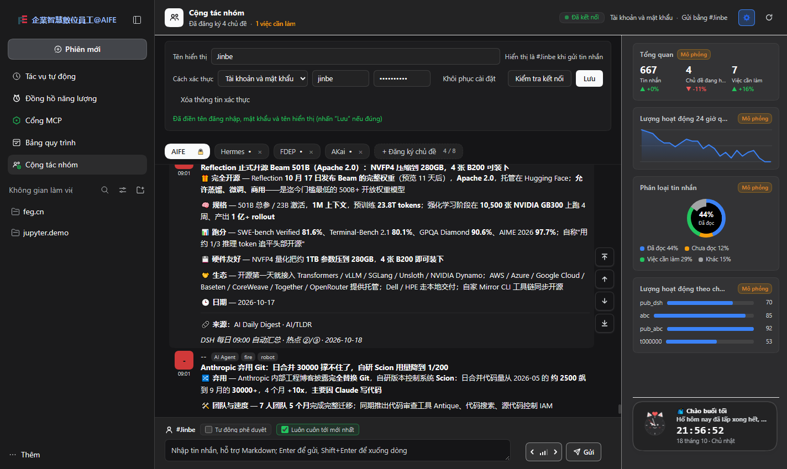

# vi-VN — Vietnamese for the DSH Web GUI

> A DSH (DeepSeek Harness) profile bundle that adds **Tiếng Việt (vi-VN)** to the
> Web GUI language picker and translates the shipped English UI copy of every
> web client namespace into Vietnamese.

DSH ships two languages — Simplified Chinese (`zh`, labelled "中文") and English
(`en`). This bundle registers Vietnamese as a real third locale through the
framework's own `LocaleRuntime.addLanguage` / `LocaleRuntime.register` API,
so the Settings picker, the durable `locale.preference` write and the
`<html lang>` sync all use the framework paths.

Unlike the reference `zhtw-traditional-chinese` bundle, this one **does not force
itself as the default**. The current UI language is left untouched; Vietnamese is
an option in **Settings → General → Language**. A browser whose OS language is
Vietnamese picks it automatically on a fresh profile (the framework matches the
`vi` primary subtag), and an explicit selection is remembered durably.



## Status

| | |
|---|---|
| locale id | `vi-VN` |
| label | `Tiếng Việt` |
| fallback | `en` |
| namespaces covered | 60 |
| keys translated | 2633 / 2633 translatable keys (100%) |
| unique English strings | 2144, all translated |
| hardcoded plugin surfaces | 584 strings translated (486 fragments + 69 patterns) across cute-clock / MCP gateway / pipeline board / team collaboration (panel, settings form, composer, tooltips) / MinIO / file-share |
| dictionary size | ~320 KB in `lib/client.js` |
| GUI verification | `node test/gui-check.js` → PASS (switch, picker, reload persistence) |
| plugin-surface verification | `node test/surface-check.js` → PASS (0 Chinese UI strings left on every sidebar panel); `node test/surface-unit.js` → PASS (MinIO/file-share scoping + data protection) |

## Install

This bundle lives in the [`cordis-plugins`](https://github.com/wuzhiping/cordis-plugins)
monorepo under `vi-VN/`. Add it to the `web` profile:

```sh
dsh plugin --profile web add "github:wuzhiping/cordis-plugins#path:/vi-VN"
```

Local clone:

```sh
git clone https://github.com/wuzhiping/cordis-plugins.git
cd cordis-plugins
dsh plugin --profile web add ./vi-VN
```

Restart the running DSH web process after installing (the package manager only
edits `~/.dsh/profiles/web/`). The first boot resolves the bundle, applies its
`cordis.patch.yml`, registers a host plugin row that the
`@deepseek-ai/dsh-client-modules` registry discovers (via
`dsh.client.platform: "web"`), and the browser fetches
`/plugins/vi-VN/client.js`.

## Verify

1. Open **Settings (or 设置 / 設定) → General → Language**.
2. The picker lists `中文`, `English`, `繁體中文` (if the zhtw bundle is installed)
   and **`Tiếng Việt`**.
3. Select `Tiếng Việt`: labels, buttons, menus, settings rows, tool cards and
   command descriptions switch immediately; `<html lang>` becomes `vi-VN`.
4. Reload the page: the choice comes back through the Host preference.

**Automated check** (headless Edge/Chrome, needs the GUI on `http://127.0.0.1:3080`):

```sh
node test/gui-check.js            # PASS/FAIL + screenshots, restores your locale
node test/gui-check.js --keep-locale
```

It reads the plugin's diagnostics surface (`window.__DSH_VI__`), switches the
locale, asserts `<html lang>`, opens Settings → General → Language, checks that
`Tiếng Việt` is listed and selected, verifies the choice after a reload, then
restores the locale that was active before the run.

Plugin surfaces (the custom bundles whose UI is hardcoded Chinese):

```sh
node test/surface-check.js         # opens every sidebar panel, counts Chinese leftovers
node test/surface-unit.js          # MinIO / file-share / data-protection unit check
node test/collect-zh.js            # dumps any leftover Chinese string for a follow-up packet
```







## How it works

A single browser-side plugin loaded into the client composition:

- `package.json` declares `dsh.bundle.patch` (so the bundle installs as a profile
  layer) and `dsh.client.platform: "web"` (so the client-modules registry lists
  it in `window.__DSH_BOOT__`). The package name is `vi-VN` — accepted by the
  profile installer as a private local bundle; it is not an npm-publishable name.
- `cordis.patch.yml` inserts the host row whose `name` is the package itself.
- `lib/index.js` is a host-side stub (a browser-only main would fail the row and
  abort boot).
- `lib/client.js` is a **generated** CJS bundle wrapped in
  `window.__ModuleLoader__.load({ id, factory })`. The factory closes over the
  Vietnamese dictionaries and returns a Cordis plugin with `inject: ['locale']`
  whose apply:

  1. **`locale.addLanguage({ id: 'vi-VN', label: 'Tiếng Việt', fallback: 'en' })`**
     — the picker row, the durable preference and the document language sync.
  2. **Patches `publish`** to keep `vi-VN` in `snapshot.locales`. This is needed
     because `zhtw-traditional-chinese` (or any locale bundle that patches
     `publish` the same way) rebuilds the snapshot from the *previous*
     `locales` list and ignores the `locales` argument; a language added later
     would be silently dropped from the picker. The shim seeds the list and
     delegates to the previous `publish`.
     It also **re-notifies `locale.subscribe` listeners** after a foreign
     `publish`: zhtw's replacement loops over `this.listeners.length` on a `Set`
     (always `0`), which otherwise stops the language row, the `<html lang>`
     sync and every React re-render after boot.
  3. **Remembers an explicit choice** in `localStorage` (`vi-VN:preference`) and
     re-asserts it after `locale.adopt()`. The Host settings mirror is
     asynchronous and can deliver a stale snapshot right after selection, which
     would otherwise adopt the previous language back; a choice of any other
     language overwrites the marker, so this never fights the user. On boot the
     recorded choice also wins over another locale plugin's forced default.
  4. **Registers** the Vietnamese dictionary of all 60 namespaces through
     `locale.register(ns, 'vi-VN', dict)` — the standard `vi-VN → en` fallback
     chain then resolves without any shim, and the shim exists for the
     incompatible `lookup`/`publish` patches above. One republish makes
     subscribers see the new catalog immediately.
  5. **Patches `lookup` and `translate`** (order-independent, delegating): when
     `vi-VN` is active they resolve from the Vietnamese table first, then hand
     the call to the untouched runtime (which reaches English through the
     chain). A last-resort Chinese fallback shows the original Chinese text for
     third-party namespaces registered without an `en` dictionary instead of a
     raw key.
  6. **Patches `resolveText`** so installed-plugin titles/descriptions (package
     `LocalizedText` maps) are translated when their resolved English string is
     in the corpus.
  7. **Runs the scoped surface layer** for the six bundles that hardcode Chinese
     (see *Custom-plugin surfaces* below); it is active only while `vi-VN` is the
     locale and restores the original nodes when the language changes.
  8. **Exposes a small diagnostics surface**, `window.__DSH_VI__` (`snapshot()`,
     `translate()`, `setLocale()`, `surface()`, `surfaceSweep()`), used by the
     verification scripts and harmless in production.
  9. **Boot restore**: a recorded Vietnamese choice wins over another locale
     plugin's forced default on activation.

`ctx.effect()` disposes every shim and removes the language and dictionaries on
plugin stop; the runtime returns to its shipped behaviour.

## Coverage

The dictionaries are **harvested** from the bundles the running GUI serves, not
written by hand. `tools/harvest.js` reads the module group list in `/`, resolves
every `/client.js` entry to its package, and parses the
`locale.register(<ns>, { zh, en })` calls (both the two-argument and the
`register(ns, 'en', dict)` shapes, quoted or bare keys).

| | |
|---|---|
| client bundles scanned | 80 |
| bundles with dictionaries | 50 |
| namespaces | 60 |
| English keys | 2637 (4 empty strings carry no text) |
| unique English strings | 2144 |
| translated | 2144 / 2144 (100% of unique strings, 2633/2633 non-empty keys) |
| identical output | 128 keys / 105 unique strings (symbol/format-only or technical keep-list: `JSON`, `PDF`, `Bash`, `{value}K`, URLs, model names…) |
| placeholder mismatches | 0 |
| Chinese characters left in values | 0 |

Translation was packetized per namespace (`tools/make-translation-tasks.js`),
translated against a shared glossary (`translations/GLOSSARY.md`) and validated
(`tools/validate-translations.js`): exact key set, `{}` placeholders, whitespace,
`…`/`·`/`\n`, no CJK, and identity strings reviewed one by one.

### Custom-plugin surfaces (hardcoded Chinese)

Six bundles installed in this profile never call `ctx.locale`: their UI copy is
hardcoded Chinese (Traditional or Simplified). Those are the panels that stayed
Chinese after a language switch:

| bundle | surface |
|---|---|
| `cute-clock` | clock card/panel (greetings, slogans, usage block, date header) |
| `fdep-api-request-bundle` | `MCP網關` panel (API id, docs/params/execute, history) |
| `kaneo-web` | `管線看板` panel (API Key setup card, iframe fallback hints) |
| `ntfy-teams` | `團隊協同` panel: dashboard, in-panel settings form (identity, auth mode, credentials, connection test), composer + priority toolbar, topic/day headers and every tooltip (`title`/`aria-label`/`placeholder`) |
| `dsh-minio-s3` | `MinIO` conversation view (bucket/object browser, upload, dialogs) |
| `dsh-file-share` | file-share conversation view (file list, share/preview dialogs) |

`tools/harvest-custom.js` extracts those literals from the installed bundles and
`tools/make-custom-tasks.js` packetizes them (513 strings, including 49 `{x}`
templates and 196 concatenation fragments). A scoped DOM layer translates them
while `vi-VN` is active:

- Scope is the plugin's own container classes (`.cute-clock-*`, `.fdep`,
  `.ntfy-teams-*`, `.kw-*`, `.ms-*`, `.fs-*`) plus sidebar panel rows; nothing
  outside those subtrees is touched.
- A render is translated only when it matches the curated Chinese corpus —
  whole text node, a `{x}` pattern, or a longest-first fragment pass (buttons
  that embed a separator, e.g. `↻ 重新整理`, use the whole-string entry as a
  substring fallback).
- `title`, `aria-label`, `placeholder` and `<option>` labels are translated too,
  so tooltips, the auth-mode select and the composer placeholder switch as well.
- Values captured by a `{x}` pattern are themselves run through the
  exact/fragment/date tables — `優先級：預設` becomes `Mức ưu tiên: Mặc định`, and
  dates inside tooltips (`用「10月9日」…`) become `Dùng ngày “9 tháng 10” …`.
- **User/remote data is never translated**: ntfy message markdown and source
  links/tags, MinIO object rows and file-share rows are on a skip list, and
  `<pre>/<code>/<textarea>` are skipped. A news headline or an object name that
  happens to contain Chinese passes through untouched.
- Switching to another language restores every original node, so zh/en/zhtw
  users see the plugin's own Chinese copy exactly as shipped.

Adding a new translation to this layer: append `{ "zh", "kind" }` to
`tools/surface-extra.json`, its Vietnamese value to
`translations/custom-vi-extra.json` (`kind` is `exact`, `fragment` or `dynamic`
with `{x}`), then rebuild. `test/collect-zh.js` lists whatever is still Chinese
on the live surfaces.

### What stays Chinese / English

- **User/remote content** — chat messages, ntfy topic messages, session titles,
  MinIO object names, file names, code and paths — is never translated.
- **scene-template** (the AI scene/mock input area) is not covered: most of its
  Chinese strings are mock scene data, not UI chrome.
- The zhtw bundle's brand override (`企業智慧數位員工@AIFE`) keeps its own copy;
  brand strings are owned by that bundle.
- Hardcoded literals of plugins outside the six above are left as shipped.

## Limitations

- `locale.preference` stores any BCP 47-style id in the current runtime, so
  `vi-VN` persists normally. On a DSH build whose settings schema only accepts
  `zh`/`en`, persistence would degrade to the local marker in step 7 (the
  selection still survives inside the same browser profile).
- The `publish`/`lookup` shims exist because `zhtw-traditional-chinese` replaces
  those methods with a hand-rolled implementation. A future DSH or a different
  locale bundle can change the shape again — `node test/gui-check.js` is the
  regression check to run after upgrading DSH or that bundle.
- The bundle is served as one module group whose content is cached until the
  profile reloads. `lib/client.js` is generated; after editing `src/client.js`
  or a translation, run `node tools/build.js`. The running host picks the new
  revision up through HMR (`mtimeMs`/`ctimeMs`/size), and a page refresh loads
  it; a profile reload/reinstall is only needed when the package itself moves.
- DSH upgrades add UI keys; re-run `node tools/harvest.js` then
  `node tools/make-translation-tasks.js` and translate the new packet — the
  build reports the new fallback keys.
- The custom-plugin surface layer matches the **rendered** text, so values built
  from `${...}` interpolation need a `{x}` pattern entry; `test/collect-zh.js`
  reports what still slips through.
- The MinIO and file-share views only mount inside a non-blank conversation, so
  the headless check cannot open them; `test/surface-unit.js` injects their real
  class-prefixed DOM and verifies both translation and user-data protection.
  Every other surface — sidebar labels, cute-clock, `MCP網關`, `管線看板`,
  `團隊協同` (dashboard, in-panel settings form, composer, tooltips) — is
  verified end-to-end by `test/surface-check.js`.

## Development

Everything below runs offline except `harvest` and the GUI checks, which need
the running DSH web process.

```sh
# 1. re-harvest the corpus from the live GUI module list
node tools/harvest.js                     # → corpus.json, strings.json

# 2. repacketize untranslated strings (5 balanced packets by default)
node tools/make-translation-tasks.js --chunks 5   # → translations/chunk-NN.json

# 3. translate each translations/chunk-NN.json → translations/vi-NN.json
node tools/validate-translations.js       # key sets, placeholders, CJK, whitespace

# 4. custom-plugin surfaces (hardcoded Chinese)
node tools/harvest-custom.js              # → tools/custom-zh.json
node tools/make-custom-tasks.js           # → translations/custom-chunk-NN.json
node tools/validate-surface.js            # key sets, {x}, CJK, fragment spaces
#    …translate the packets to translations/custom-vi-NN.json, or use custom-vi-extra.json
# 5. generate the browser bundle
node tools/build.js --dry                 # validate + report
node tools/build.js                       # → lib/client.js

# 6. verify the running GUI
node test/gui-check.js                    # locale switch, picker, reload persistence
node test/surface-check.js                # every sidebar panel: Chinese leftovers
node test/surface-unit.js                 # MinIO/file-share scoping + data protection
node test/diag.js                         # locale state, console errors, requests
```

- `corpus.json` / `strings.json` are generated inputs (kept in the repo so the
  dictionary is reproducible without a running host).
- `translations/vi-NN.json` are the only hand-authored translation sources;
  `lib/client.js` is always regenerated by `tools/build.js` and starts with a
  `GENERATED by tools/build.js` banner.
- `test/gui-check.js` drives headless Edge/Chrome over the DevTools protocol
  (no extra dependency: Node's built-in `fetch`/`WebSocket`), and restores the
  locale it found so running it never changes the user's setting.
- `test/diag.js` prints the locale snapshot, live publish events, console errors
  and failed requests — the first stop when a shim stops applying.
- Surface-layer inputs: `tools/custom-zh.json` (harvested from the installed
  bundles), `translations/custom-chunk-NN.json` / `custom-vi-NN.json` (packets),
  and `tools/surface-extra.json` + `translations/custom-vi-extra.json` (manual
  follow-ups found by `test/collect-zh.js`). `tools/validate-surface.js` checks
  key sets, `{x}` counts, CJK and fragment whitespace before a build.

## License

MIT — see the [LICENSE at the monorepo root](https://github.com/wuzhiping/cordis-plugins/blob/main/LICENSE).
